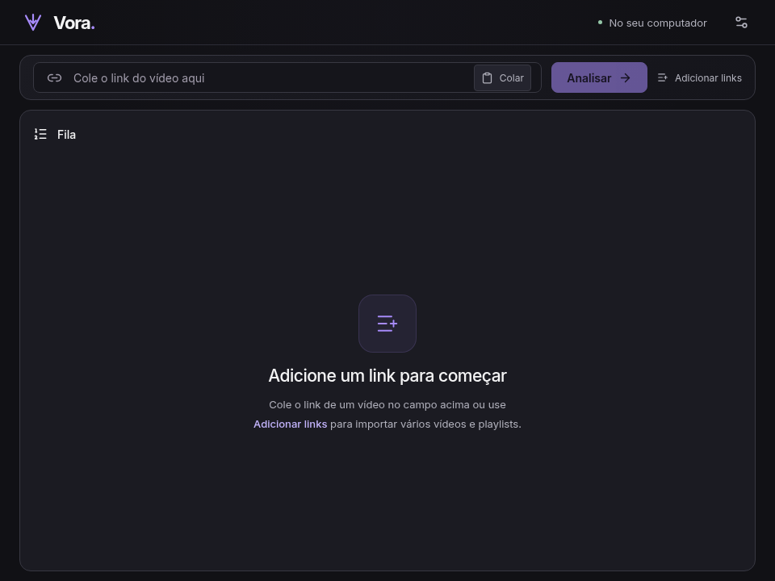
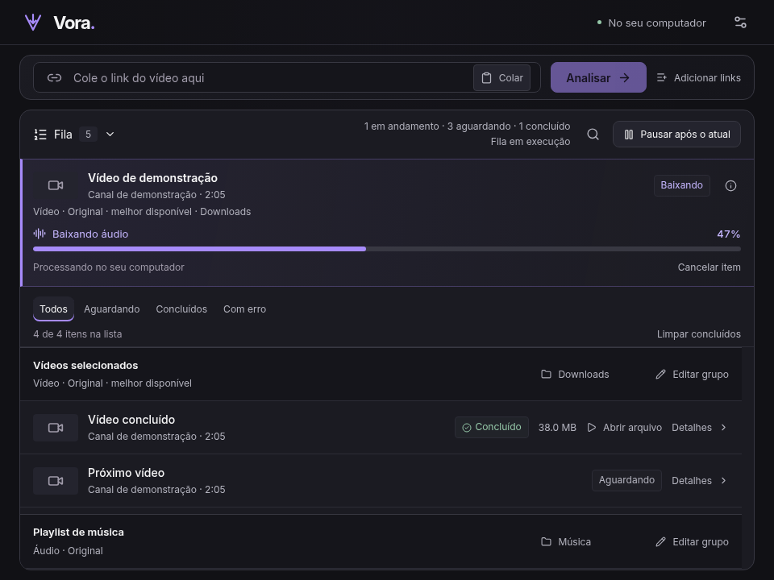

# Vora

[](https://github.com/justmatedev/vora/actions/workflows/ci.yml)

**Áudio e vídeo, do seu jeito.**

Aplicativo desktop de código aberto desenvolvido por **justmatedev** para baixar áudio e vídeo do YouTube e de Reels públicos do Instagram no Linux e Windows. Cole um link, escolha o formato e acompanhe seus downloads em uma fila. Interface em português, tema escuro e processamento no seu computador.



## Recursos

- Vídeos individuais, Shorts, vários links e seleção de vídeos de playlists públicas do YouTube.
- Reels públicos do Instagram, com vídeo original, áudio original e MP3, na mesma fila.
- Vídeo original ou MP4 compatível, com qualidades disponíveis na fonte e sem aumentar a resolução.
- Áudio original ou MP3.
- Fila sequencial com configuração e pasta por grupo, busca e filtros.
- Progresso da faixa ativa, cancelamento e novas tentativas para falhas temporárias.
- Fila persistente, recuperação de interrupções e proteção contra sobrescrita.
- Notificações do sistema e ações para abrir ou localizar arquivos concluídos.
- Transcrição local opcional com Whisper Small ou Medium, em uma aba própria, para downloads concluídos e arquivos do computador; exportação TXT e SRT. Disponível nesta árvore de desenvolvimento, ainda sem nova Release.



A captura da fila usa dados de teste.

## Download

A versão estável publicada é **0.7.0**, para **Linux e Windows x64**. Baixe os instaladores na [Release 0.7.0](https://github.com/justmatedev/vora/releases/tag/v0.7.0):

| Sistema | Arquivo                                                                                                             |
| ------- | ------------------------------------------------------------------------------------------------------------------- |
| Linux   | [AppImage Linux](https://github.com/justmatedev/vora/releases/download/v0.7.0/Vora-0.7.0-linux-x86_64.AppImage)     |
| Windows | [Instalador Windows](https://github.com/justmatedev/vora/releases/download/v0.7.0/Vora-0.7.0-windows-x64-setup.exe) |

Os pacotes incluem yt-dlp e FFmpeg/ffprobe, usando o Node.js incluído no Electron. O usuário final não precisa instalar essas ferramentas ou Node.js separadamente. O AppImage pode exigir FUSE ou a opção `--appimage-extract-and-run`. O instalador Windows não possui assinatura digital.

O AppImage oficial passou na validação automatizada no Linux. Em 18 de novembro de 2026, o mantenedor confirmou as validações pendentes da 0.7.0. Veja os detalhes e a distinção entre testes automatizados e relato do mantenedor em [VALIDATION.md](docs/VALIDATION.md).

## Atualizações no aplicativo

A partir da versão **0.6.0**, o Vora verifica novas versões ao abrir e oferece **Configurações → Atualizações**. O download depende do botão **Baixar atualização** e a instalação de **Reiniciar e atualizar**, com a fila pausada e sem trabalho ativo. Fechar normalmente o Vora não instala uma atualização baixada.

Quem usa **0.5.1 ou anterior** precisa instalar manualmente a primeira versão com o recurso. As próximas poderão ser atualizadas dentro do app. No Linux, use o AppImage em uma pasta onde você tenha permissão de escrita; a atualização preserva seu nome e caminho. Se a atualização interna estiver indisponível, há acesso à página de versões.

## Começar a desenvolver

Requisitos: Node.js **22.12 ou superior**, npm e ambiente gráfico Linux ou Windows x64.

```sh
git clone https://github.com/justmatedev/vora.git
cd vora
npm ci
npm run tools:fetch
npm run dev
```

Stack: **Electron + React + TypeScript + Vite**, com ferramentas executadas localmente.

## Documentação

- [Guia de uso](docs/USAGE.md): formatos, fila, playlists, notificações e recuperação.
- [Desenvolvimento](docs/DEVELOPMENT.md): instalação, arquitetura, testes e empacotamento.
- [Identidade visual](docs/VISUAL_IDENTITY.md): marca, cores, tipografia e hierarquia da interface.
- [Publicação no GitHub](docs/RELEASING.md): preparação do repositório e das versões.
- [Histórico de mudanças](CHANGELOG.md).
- [Validação por versão](docs/VALIDATION.md).
- [Componentes de terceiros](THIRD_PARTY.md).

## Sugestões e contribuições

Para relatar problemas ou sugerir melhorias, [abra uma issue](https://github.com/justmatedev/vora/issues/new/choose) com a versão do Vora, seu sistema e os passos para reproduzir. Combine mudanças maiores antes de implementá-las. Para enviar código, siga o [guia de desenvolvimento](docs/DEVELOPMENT.md), execute os testes relevantes e disponibilize sua contribuição sob a licença MIT do projeto.

## Limites e licença

Suporte a vídeos e playlists públicas finitas do YouTube e a Reels públicos do Instagram acessíveis sem login. Fotos, carrosséis, Stories e perfis do Instagram não são suportados. Sem macOS, login/cookies, canais, mixes automáticos, lives em andamento ou downloads simultâneos. A atualização interna está disponível desde a versão 0.6.0. Mudanças no YouTube ou Instagram podem exigir atualização das ferramentas. Para Reels sem H.264/AAC disponível, selecione Original; o aplicativo não reconverte vídeo nem troca o formato automaticamente.

O código do Vora é disponibilizado sob a [licença MIT](LICENSE), com copyright de **justmatedev**. As dependências e os executáveis incluídos conservam suas próprias licenças; consulte [THIRD_PARTY.md](THIRD_PARTY.md) e os materiais de fontes disponibilizados junto às Releases.

O nome Vora foi escolhido para uso pessoal; a disponibilidade comercial não foi verificada.
