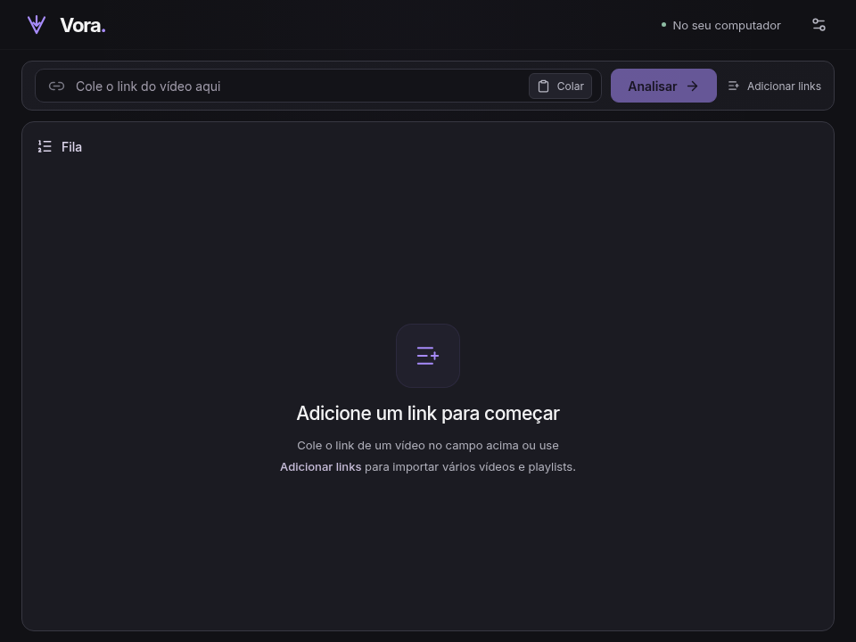
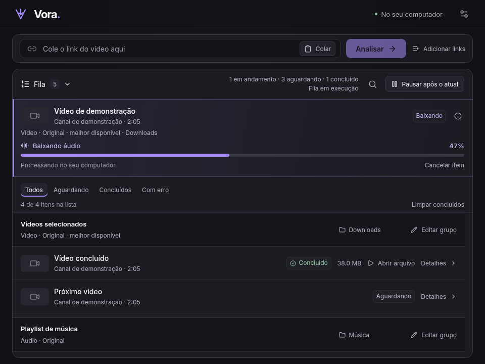

# Vora

[](https://github.com/justmatedev/vora/actions/workflows/ci.yml)

**Áudio e vídeo, do seu jeito.**

Aplicativo desktop de código aberto desenvolvido por **justmatedev** para baixar áudio e vídeo do YouTube no Linux e Windows. Cole um link, escolha o formato e acompanhe seus downloads em uma fila. Interface em português, tema escuro e processamento no seu computador.



## Recursos

- Vídeos individuais, Shorts, vários links e seleção de vídeos de playlists públicas.
- Vídeo original ou MP4 compatível, com qualidades disponíveis na fonte e sem aumentar a resolução.
- Áudio original ou MP3.
- Fila sequencial com configuração e pasta por grupo, busca e filtros.
- Progresso da faixa ativa, cancelamento e novas tentativas para falhas temporárias.
- Fila persistente, recuperação de interrupções e proteção contra sobrescrita.
- Notificações do sistema e ações para abrir ou localizar arquivos concluídos.



A captura da fila usa dados de teste.

## Download

A versão atual é **0.5.1**, para **Linux e Windows x64**. Os instaladores ainda não foram publicados. Quando disponíveis, estarão na seção [Releases](https://github.com/justmatedev/vora/releases). Os nomes esperados para esta versão são:

| Sistema | Arquivo                            |
| ------- | ---------------------------------- |
| Linux   | `Vora-0.5.1-linux-x86_64.AppImage` |
| Windows | `Vora-0.5.1-windows-x64-setup.exe` |

Os pacotes incluem yt-dlp e FFmpeg/ffprobe, usando o Node.js incluído no Electron. O usuário final não precisa instalar essas ferramentas ou Node.js separadamente. O AppImage pode exigir FUSE ou a opção `--appimage-extract-and-run`. O instalador Windows não possui assinatura digital.

A versão Linux empacotada foi verificada. A validação nativa Windows da versão 0.5.1 está pendente; veja [VALIDATION.md](docs/VALIDATION.md).

## Começar a desenvolver

Requisitos: Node.js **22.12 ou superior**, npm e ambiente gráfico Linux ou Windows x64.

```sh
git clone https://github.com/justmatedev/vora.git
cd vora
npm ci
npm run tools:fetch
npm run dev
```

Stack: **Electron + React + TypeScript + Vite**, com ferramentas executadas localmente.

## Documentação

- [Guia de uso](docs/USAGE.md): formatos, fila, playlists, notificações e recuperação.
- [Desenvolvimento](docs/DEVELOPMENT.md): instalação, arquitetura, testes e empacotamento.
- [Publicação no GitHub](docs/RELEASING.md): preparação do repositório e das versões.
- [Histórico de mudanças](CHANGELOG.md).
- [Validação por versão](docs/VALIDATION.md).
- [Componentes de terceiros](THIRD_PARTY.md).

## Sugestões e contribuições

Para relatar problemas ou sugerir melhorias, [abra uma issue](https://github.com/justmatedev/vora/issues/new/choose) com a versão do Vora, seu sistema e os passos para reproduzir. Combine mudanças maiores antes de implementá-las. Para enviar código, siga o [guia de desenvolvimento](docs/DEVELOPMENT.md), execute os testes relevantes e disponibilize sua contribuição sob a licença MIT do projeto.

## Limites e licença

Suporte a vídeos públicos e playlists públicas finitas. Sem macOS, login/cookies, canais, mixes automáticos, lives em andamento ou downloads simultâneos. Atualização manual por nova versão do aplicativo. Mudanças no YouTube podem exigir atualização das ferramentas.

O código do Vora é disponibilizado sob a [licença MIT](LICENSE), com copyright de **justmatedev**. As dependências e os executáveis incluídos conservam suas próprias licenças; consulte [THIRD_PARTY.md](THIRD_PARTY.md) e os materiais de fontes disponibilizados junto às Releases.

O nome Vora foi escolhido para uso pessoal; a disponibilidade comercial não foi verificada.
