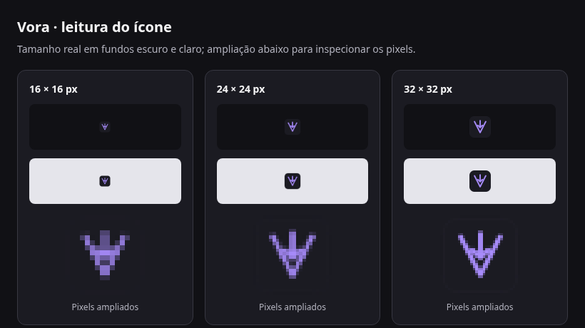

# Identidade visual do Vora

O Vora usa superfícies escuras, tipografia Inter e lavanda para transmitir clareza, organização e autonomia. A assinatura verbal é **Áudio e vídeo, do seu jeito.**

## Marca

O símbolo combina um V com uma seta de download. A seta termina antes da ponta do V para preservar o espaço interno em tamanhos pequenos. O nome no aplicativo usa peso 700 e um ponto lavanda.

A geometria do cabeçalho está em `src/App.tsx`; o ícone de instalação está em `assets/icon.svg`. Mantenha os dois desenhos alinhados e regenere `assets/icon.png` e `public/icon.png` ao alterar o SVG. Confira a leitura em 16, 24 e 32 px, além do ícone de 512 px.

A prancha registra a renderização no navegador em escala 1×. A aparência na barra de tarefas do Windows ainda precisa de conferência no próprio sistema.

## Cores e hierarquia

Os tokens ficam no início de `src/styles.css`.

| Token                               | Uso                                                    |
| ----------------------------------- | ------------------------------------------------------ |
| `--canvas`                          | Fundo da janela e campos de busca                      |
| `--surface`                         | Painéis principais                                     |
| `--surface-inset`                   | Cabeçalhos de grupo e detalhes expandidos              |
| `--surface-hover`                   | Ações secundárias, seleção de filtro e realce de linha |
| `--border` / `--divider`            | Contornos de componentes e separação de conteúdo       |
| `--text`                            | Títulos e informações principais                       |
| `--muted` / `--subtle`              | Metadados, ações secundárias e informações auxiliares  |
| `--accent` / `--accent-text`        | Marca, ação principal, progresso e foco                |
| `--accent-soft` / `--accent-border` | Fundo e contornos do download ativo                    |
| `--focus-ring`                      | Indicador de foco pelo teclado                         |
| `--disabled-opacity`                | Opacidade uniforme de controles desabilitados          |

Reserve o lavanda para os pontos de maior importância. Ações secundárias usam texto neutro; sucesso e erro mantêm cores semânticas acompanhadas de rótulos. O item ativo recebe uma borda lateral lavanda e uma barra de progresso. Os grupos usam fundo rebaixado, título em seminegrito e separação entre lotes.

## Tipografia e espaçamento

Use Inter nos pesos 400, 500, 600 e 700. Na fila, `--font-title` (14 px) identifica vídeos, `--font-body` (13 px) identifica grupos e conteúdo, e `--font-caption` (12 px) atende metadados e ações. Evite reduzir textos operacionais abaixo de 12 px.

Use os tokens de espaçamento de 4, 8, 12 e 16 px. Os raios de controles e painéis usam `--radius-control` e `--radius-panel`.

## Comportamento visual

Linhas destacam hover e foco interno. O foco pelo teclado usa um contorno de 2 px, inclusive nos campos de link, busca, seleção, texto e caixas de seleção. Campos sem contorno próprio mostram o foco no seu contêiner. A seleção de filtros combina superfície, texto e sublinhado; preserve os indicadores de foco pelo teclado e a preferência por movimento reduzido.

Controles desabilitados usam o mesmo token de opacidade, mostram cursor de indisponibilidade e não recebem realce de hover, inclusive quando desabilitados por um `fieldset`. As escolhas de vídeo e playlist preservam o destaque durante o hover e informam a seleção com `aria-pressed`.

Mantenha uma única regra por seletor em cada contexto de mídia. Remova estilos de componentes descartados e reúna as mudanças de cada breakpoint no mesmo bloco. Os modificadores `.compact-layout` e `.queue-layout` definem a distribuição da janela e da fila.

Em janelas de até 700 px, busca, resumo e ações podem ocupar linhas adicionais. A lista mantém sua própria rolagem, com o download ativo e seus controles fora dela. Confira títulos longos, grupos intercalados, avisos e diálogos em janelas pequenas ao alterar a densidade da interface.

A busca da fila abre automaticamente a partir de 10 itens, sem contar o download ativo e antes de aplicar busca ou filtros. A lupa permite abri-la em filas menores. Fechar a busca limpa o texto e devolve o foco ao botão; os filtros continuam disponíveis. Uma busca em uso permanece visível quando a fila diminui.
